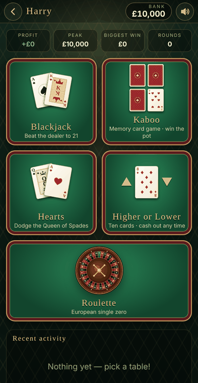
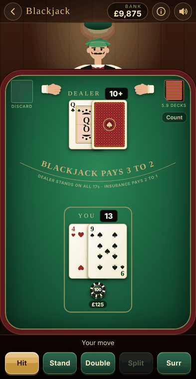
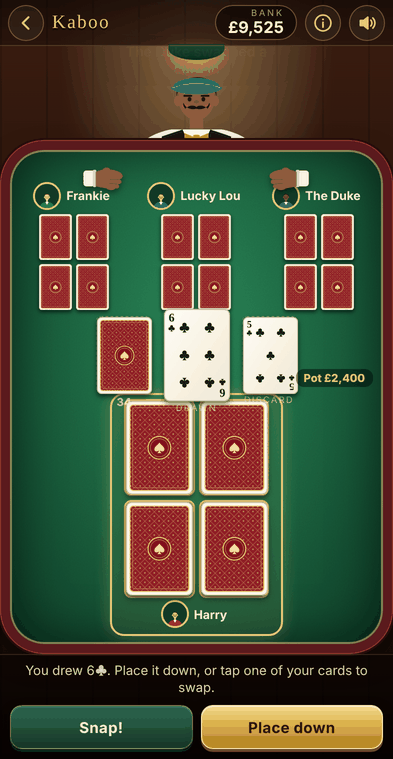
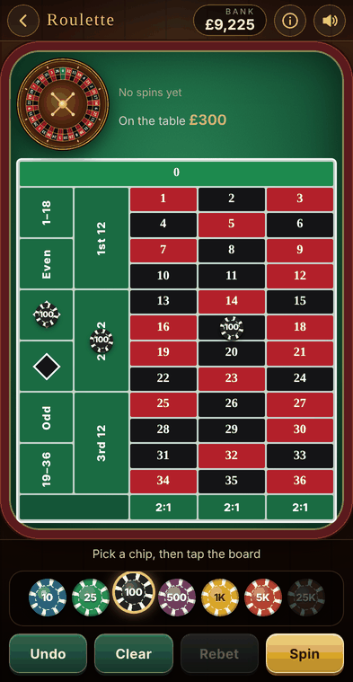
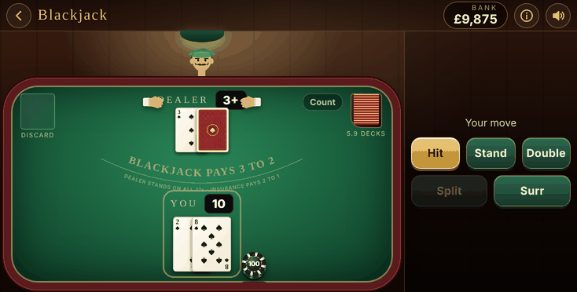

# Casino Master

A retro casino for iPhone with five games and a play-money bankroll. Each save starts with **£10,000**. Work it up or lose the lot.

| Game | What it is |
| --- | --- |
| **Blackjack** | 6-deck shoe, blackjack pays 3:2, dealer stands on 17. Double, split (up to 4 hands), surrender, insurance. Optional Hi-Lo count display. |
| **Kaboo** | Memory card game against 1–3 AI opponents. Lowest points takes the pot. |
| **Hearts** | Classic 4-player Hearts: passing rotation, breaking hearts, shooting the moon. Play to 50 or 100. |
| **Higher or Lower** | Ten cards in a row. Guess each next card. The multiplier grows with every correct call, and you can cash out at any time. |
| **Roulette** | European single-zero wheel with straight, dozen, column, red/black, odd/even and high/low bets. |

The app works in **portrait and landscape**. Rotate the phone and the table re-lays itself out, with the controls moving to the side.

Save games: **New Game** creates a new save with £10,000. **Load Game** lists every save with its balance. Saves are written to the phone after every round.

<p>




</p>
<p></p>

## Kaboo rules (as implemented)

- Everyone gets 4 face-down cards. At the start you see your **bottom two** once. Memorise them.
- On your turn, draw from the deck. You can **place it down** (discard) or **swap** it for one of your face-down cards; the old card is placed down.
- Powers only trigger when a card is placed down **straight from the deck**:
  - **7**: look at one of your own cards
  - **8**: look at one of someone else's cards
  - **9**: blind swap one of yours with someone else's
  - **10**: look at someone else's card, then choose whether to swap
- **Snap:** at any time, if you think one of your cards matches the number on top of the discard pile, tap **Snap!** and then that card. If you're right, it's gone. If you're wrong, it's shown and you take a penalty card.
- **Kaboo:** at the start of your turn (after the first round) you can call Kaboo. You still take that turn, everyone else gets one more, then all cards are revealed.
- Points: A = 1, 2–10 = face value, J = 11, Q = 12, **black K = 0**, **red K = 20**. Lowest score wins the pot; ties split it.

## Getting it onto your iPhone (iLoadly / Sideloadly)

Every push to GitHub runs the **Build iOS app (.ipa)** workflow (`.github/workflows/build-ipa.yml`). It runs on a macOS runner, builds an **unsigned** `CasinoMaster.ipa`, and publishes it:

- as a download on the **Releases** page, under the release called **latest**, and
- as a workflow artifact called `CasinoMaster-ipa`.

1. Download `CasinoMaster.ipa` from the latest release.
2. Open it in iLoadly (or Sideloadly or AltStore). It signs the app with your Apple ID and installs it.
3. The first time you open the app, go to **Settings → General → VPN & Device Management** and trust your Apple ID. On iOS 16+ you may also need to turn on **Settings → Privacy & Security → Developer Mode**.

With a free Apple ID, sideloaded apps expire after 7 days. Re-install from the same `.ipa` to refresh it. Your saves are kept as long as you don't delete the app.

## Project layout

```
web/                 the whole game: HTML/CSS/JS, no build step, no network needed
  js/games/          blackjack.js, kaboo.js, hearts.js, hilo.js, roulette.js
ios/                 native shell (Swift, WKWebView): saves to the device, haptics, rotation
  project.yml        XcodeGen spec, used by the CI build
tests/               rules tests, browser soak test, screenshot + icon scripts
```

You can also play in any browser by opening `web/index.html`.

### Running the tests

```
node tests/logic.test.js     # rules & payouts
node tests/soak.js           # plays hundreds of rounds in Chromium, checks the bankroll always adds up
node tests/shots.js out 2    # screenshots in portrait + landscape
```

Play money only. There is no real-money gambling.
